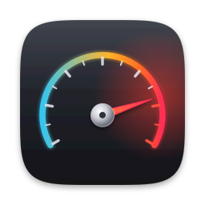

# Overdrive

**Power tools for your Mac.**
70+ small tools that macOS is missing — Finder, windows, Dock, apps, keyboard, screen, clipboard,
files and more — in one native menu bar app for macOS 14+. **Free and open source** (MIT).

**[Download Overdrive](https://github.com/Lightmaster00/overdrive/releases/latest/download/Overdrive.dmg)** · [Website](https://lightmaster00.github.io/overdrive/) · [All releases](https://github.com/Lightmaster00/overdrive/releases)



## Install

1. Download `Overdrive.dmg`, open it and drag **Overdrive** into *Applications*.
2. On first launch, macOS may say the app comes from an unidentified developer:
   open *System Settings › Privacy & Security* and click **Open Anyway**.
3. Overdrive opens its settings: turn on the tools you want. Some need a permission
   (Accessibility, Screen Recording); the settings show which, with a button to allow it.

Overdrive lives in the menu bar: its menu runs the actions you choose, and every tool can have a
global shortcut. Updates install from inside the app, in one click.

## How it works

- **Tweaks** change how your Mac behaves while they're on (cut and paste in Finder, Hyper key…).
  Everything is off until you turn it on.
- **Actions** run once, from the menu or a shortcut (hide all windows, copy text from the screen…).
- **App shortcuts**: a global shortcut opens an app, or hides it if it's already in front.
- Search any tool from the settings sidebar.

The interface follows the system language (English, French, Spanish, German, Japanese; English otherwise).

## Tools

### Finder

- **Cut and paste files** — ⌘X then ⌘V moves the selected files, like on Windows.
- **Return opens, F2 renames** — Return opens the selection; Shift-Return or F2 renames it.
- **Delete key moves to Trash** — No need for ⌘⌫.
- **⌥N creates a text file** — Creates an empty text file in the current folder and lets you name it.
- **Open a window when Finder is activated** — From the Dock or ⌘Tab, when no Finder window is open (not when clicking the desktop).
- **Context menu actions** — Right-click › Overdrive: new text file, copy path or name, Markdown link, open in Terminal, SHA-256, make executable, symlink, unquarantine, hidden files, delete immediately. Turn it on in System Settings › Login Items & Extensions too.
- **Copy path of selection** — Copies the full path of the selected Finder items.
- **Open Terminal here** — Opens Terminal in the folder shown in Finder.
- **Show hidden files** — Shows or hides hidden files everywhere in Finder.
- **Show or hide Finder** — Best with a shortcut.

### Windows

- **Hide all windows** — Hides every app to show the desktop.
- **Isolate the front app** — Hides every other app.
- **Minimize all windows** — Sends every window to the Dock.
- **Minimize all but the front app** — Keeps only the windows of the app you're using.
- **Restore the front app's windows** — Brings back its minimized windows.
- **Center the front window** — Moves it to the middle of its screen.
- **Fill the screen with the front window** — Without full screen mode; again to restore.
- **Green button fills the screen** — Instead of full screen mode. Hold ⌥ for the usual behavior.
- **Yellow button hides the app** — Instead of minimizing the window. Hold ⌥ for the usual behavior.
- **Restore minimized windows when switching** — ⌘Tab to an app whose windows are all in the Dock brings them back.

### Dock

- **Click the active app's icon to hide it** — Like the Windows taskbar.
- **Show the hidden Dock instantly** — Removes the delay before an automatically hidden Dock appears.
- **Add a spacer to the Dock** — Drag it where you want; drag it out to remove it.
- **Add a small spacer to the Dock** — Half the width of an icon.

### Apps

- **Press ⌘Q twice to quit** — No more apps quit by accident.
- **Quit all apps** — Except Finder and the apps you exclude.
- **Quit all apps but the front one** — Same exclusions as above.
- **Hide inactive apps** — Hides apps you haven't used for a while.
- **Offer to install apps from disk images** — Opening a DMG with an app offers to copy it to Applications and eject the disk.
- **Stop Music from opening by itself** — After the Play key or when headphones connect.

### Keyboard

- **Hyper key** — Caps Lock becomes ⌃⌥⇧⌘: a modifier of its own for your shortcuts.
- **Remove the Caps Lock delay** — Caps Lock turns on with a quick tap.
- **Delete goes back in Safari** — Shift-Delete goes forward.
- **Play a sound when a shortcut runs** — For Overdrive's shortcuts.

### Mouse & trackpad

- **Three-finger click = middle click** — Opens links in a new tab, closes tabs… on the trackpad.
- **Center the pointer after wake** — Also after unlocking: easy to find on large screens.

### Screen capture

- **Copy text from the screen** — Select an area: its text is recognized and copied, in any language.
- **Scan a QR code or barcode** — Select the area: the content is copied.
- **Pick a color** — Copies the color under the pointer.

### Screenshots

- **Copy new screenshots** — Every screenshot is saved and also put on the clipboard.
- **Open the latest screenshot** — In its default app.
- **Show the pointer in screenshots** — For tutorials.
- **Save screenshots instantly** — Without the floating thumbnail.
- **Archive old screenshots** — Moves them to a “Screenshots Archive” folder.

### Audio

- **Mute sound** — Of the current output.
- **Mute the microphone** — For calls: best with a shortcut.
- **Next sound output** — Speakers, headphones, AirPods…
- **Next sound input** — Switches microphone.
- **Limit the volume after wake** — No blast of sound when you open your Mac in a quiet room.

### Clipboard

- **Clear the clipboard** — After copying a password, for example.
- **Clear the clipboard automatically** — A while after the last copy.
- **Clear the clipboard when locking** — And when the Mac goes to sleep.

### Files

- **Empty the Trash** — After confirmation.
- **Eject all disks** — External drives, disk images, SD cards…
- **Archive old downloads** — Keeps the Downloads folder tidy: old items go to Downloads › Archive.
- **Lowercase download extensions** — PHOTO.JPG becomes PHOTO.jpg.
- **Put AirDropped files in a folder** — Instead of mixing them with your downloads.

### Display & appearance

- **Dark Mode** — Switches between light and dark.
- **Night Shift** — Warmer colors in the evening.
- **True Tone** — On supported displays.
- **Grayscale** — Less distracting screen.
- **Show desktop icons** — Hide them before sharing your screen.
- **Hot Corners** — Turn them off for a game or a presentation; your settings come back after.
- **Turn off the displays** — The Mac keeps running.
- **Start the screen saver** — Right now.

### System

- **Keep the Mac awake** — Until you turn it off.
- **Lock the screen** — Immediately.
- **Flush the DNS cache** — Fixes sites that don't load after a change. Asks for your password.
- **TextEdit opens a blank document** — Instead of the file dialog.
- **Open VPN settings** — A pane that's hard to find.

### Utilities

- **Cleaning Mode** — Black screen, keyboard and trackpad locked: clean them safely. Hold Esc to leave.
- **Cat Mode** — Locks the keyboard and mouse but keeps the screen visible. Hold Esc to leave.
- **Clear notifications** — Closes the notifications on screen.
- **Shortcuts in the menu** — Run your shortcuts from the Shortcuts app from Overdrive's menu.

## Permissions and privacy

Overdrive works entirely on your Mac: no account, no analytics, no network access except checking
GitHub for updates.

- **Accessibility**: to see and adjust keyboard and mouse events (Finder keys, window buttons, Dock,
  Hyper key, ⌘Q guard…). Overdrive never records what you type.
- **Screen Recording**: only when you copy text or read a code from the screen.
- **Automation**: Finder (selection and open folder) and System Events (Dark Mode), asked on first use.
- The **Finder extension** is sandboxed: it copies text to the clipboard itself and asks the app
  (through a local notification, unreachable from the web) for anything that changes files.

## Development

```bash
./build.sh install   # build, install /Applications/Overdrive.app and relaunch
./build.sh test      # automated tests
./build.sh run       # launch the build/ copy without installing it
./build.sh dmg       # build/Overdrive.dmg
```

Builds are signed with the "Overdrive Signing" certificate from your keychain (created on the first
build), so macOS keeps its permissions between builds. Every push builds the app, runs the tests
(including with the Address and Thread Sanitizers) and produces a DMG on a Mac.

## Publishing a release

1. Change `CFBundleShortVersionString` in `Resources/Info.plist` (e.g. `1.0.1`) and push to `main`.
2. GitHub tests the app, builds and signs it, and publishes `Overdrive.dmg` and `Overdrive.zip`
   (in-app updates) on the [Releases](https://github.com/Lightmaster00/overdrive/releases) page.

**One-time setup** (repository owner): `./build.sh setup-signing` creates the signing certificate,
installs it in your keychain and stores it as a GitHub secret.

## Project layout

```
Sources/Overdrive/
  AppDelegate.swift      entry point and menu bar menu
  SettingsView.swift     settings window (categories, search, permissions, app shortcuts)
  ToolKit.swift          tools, categories, options, shortcuts, app launchers
  ToolCatalog.swift      every tool with its texts
  FinderTools.swift      Finder tools and the extension's requests
  WindowTools.swift      windows, Dock and apps
  KeyboardTools.swift    keyboard (Hyper key…) and mouse
  ScreenTools.swift      text recognition, codes, color picker, region selection
  MoreTools.swift        audio, clipboard, files, screenshots, display, system, utilities
  InputLock.swift        Cleaning Mode and Cat Mode
  EventTap.swift         the single keyboard and mouse event tap
  Core.swift             preferences, shell, AppleScript, permissions, Accessibility helpers
  HotKeys.swift, Shortcuts.swift, HUD.swift, Updater.swift, Localization.swift, Brand.swift
Extension/FinderSync.swift   Finder context menu extension (sandboxed)
Tests/OverdriveTests/        tests (catalog, files, checksums, colors, key mappings…)
Branding/                    icon, menu bar icon, installer background, brand guide
site/                        website (GitHub Pages)
```

## License

MIT — see [LICENSE](LICENSE). Inspired by [Supercharge](https://sindresorhus.com/supercharge) by
Sindre Sorhus; Overdrive is an independent implementation.
